# Warhammer 40,000: Rogue Trader

A free hint guide for Warhammer 40,000: Rogue Trader, with spoiler levels you control. Get help with Owlcat's grimdark CRPG in the Koronus Expanse. Your AI agent answers only from the guide files and tracks your place between sessions.

## Use it

Install the [reader](https://github.com/hintforge/reader) in any AI agent that can read files on your computer, then tell it:

> Load the Rogue Trader guide from github.com/hintforge/warhammer-40-000-rogue-trader

Try "how do I build this companion", "how do I beat this fight" or "where was I".

The guide uses the [Hintforge](https://github.com/hintforge/builder) format. The agent reads and writes only files you control.

## Spoilers

Enemy warnings (Tier 0 to 5) and puzzle hints (Tier 0 to 3) start silent. Raise either dial for more help, up to boss strategy or a walkthrough. Save recaps can reveal party and game state. No save-reader leak has been recorded.

## What's inside

- The full base campaign: quests, puzzles, crew, factions, items, detailed stat math and all achievements.
- An interactive build planner at `artifacts/build_planner.html`. It opens with an example party. Change characters, ranks and picks to match yours; Export / Import keeps your plan.
- `extract_tools/save_import.py` imports your party into the planner. See `artifacts/README.md` for the two commands.

## How current it is

Last checked against Build 21262645 (May 2026). Patch 1.6 and The Infinite Museion DLC arrived in June and July 2026, after that check. Their changes and content aren't reflected yet.
